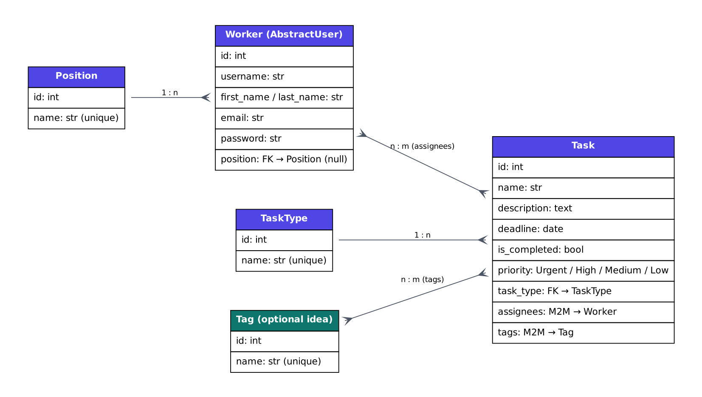
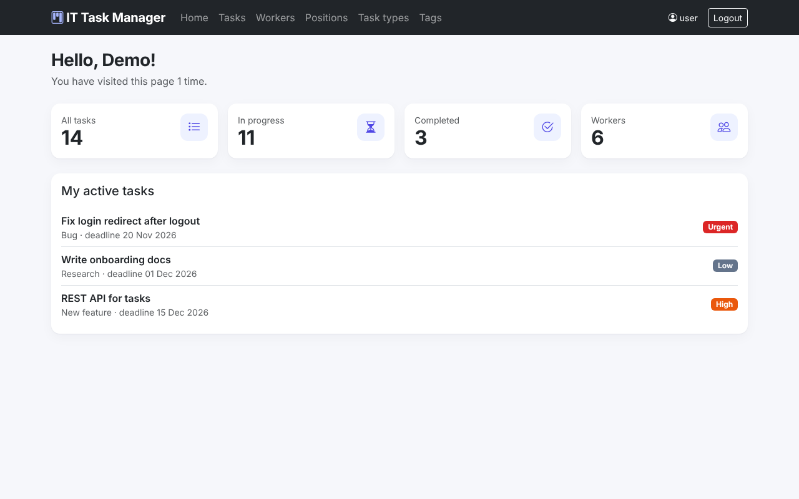
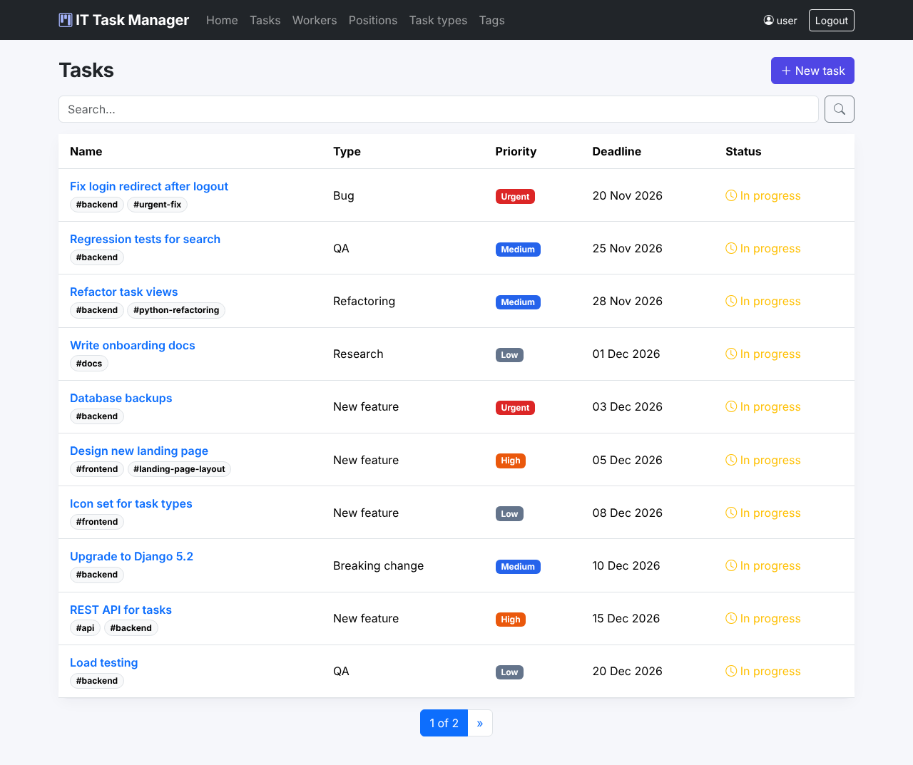
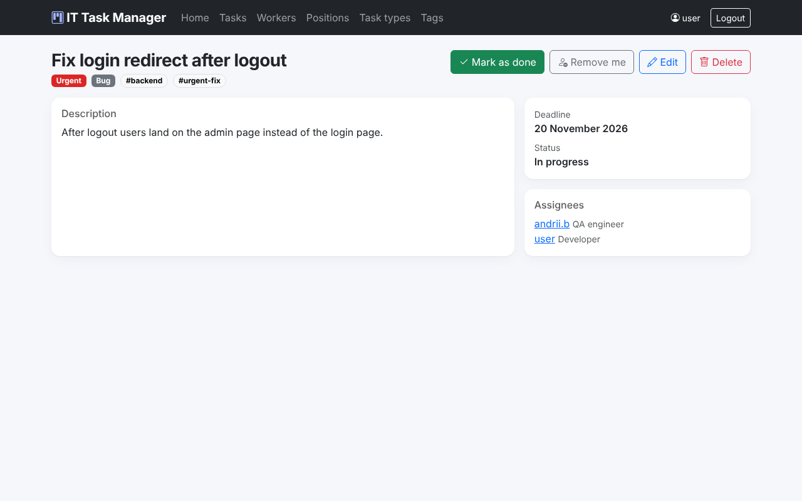
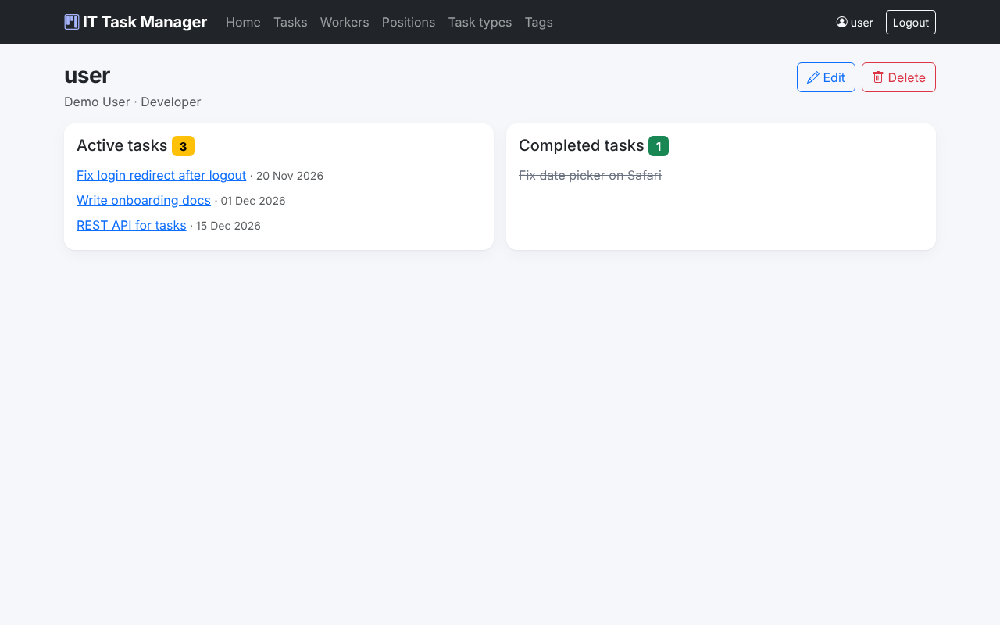

# IT Company Task Manager

A task manager for an IT team. Developers, designers, project managers and QA
engineers create tasks, assign them to each other, tag them and mark them as
completed — ideally before the deadline.

Built with Django 5.2 as the portfolio project of the Mate academy Django module.

## Features

- Dashboard with task statistics and the current user's active tasks
- Tasks: priority (urgent / high / medium / low), task type, deadline, tags,
  several assignees; "Mark as done" and "Assign me" buttons
- Workers with positions; a worker's page shows active and completed tasks
- Full CRUD for tasks, workers, positions, task types and tags
- Search on every list page; pagination keeps the search query
- Login / logout; every page requires authentication
- Custom user model (`Worker` extends `AbstractUser`)
- Admin panel with filters and search
- 27 tests (models, forms, views, admin)
- Ready for Render: split settings, PostgreSQL via `DATABASE_URL`,
  WhiteNoise for static files, gunicorn

## Demo access

```
login: user
password: user12345
```

## Run locally

```bash
git clone https://github.com/KorJ4/it-company-task-manager.git
cd it-company-task-manager
python -m venv venv
source venv/bin/activate            # Windows: venv\Scripts\activate
pip install -r requirements.txt
python manage.py migrate
python manage.py load_demo_data     # demo positions, workers and tasks
python manage.py runserver
```

Open http://127.0.0.1:8000/ and log in with the demo user above.
Local development uses SQLite and `config.settings.dev` (the default for
`manage.py`).

Run the tests and the linter:

```bash
python manage.py test
flake8
```

## Deploy to Render

1. Create a PostgreSQL database (for example on Neon) and copy its
   connection URL.
2. On Render create a **Web Service** from this repository:
   - Build command: `./build.sh`
   - Start command: `gunicorn config.wsgi:application --workers 1 --threads 10`
3. Add environment variables (see `.env.sample`):
   `DJANGO_SETTINGS_MODULE=config.settings.prod`, `SECRET_KEY`,
   `DATABASE_URL`, `RENDER_EXTERNAL_HOSTNAME`.

`build.sh` installs packages, collects static files, applies migrations and
loads the demo data once.

## Database structure



## Screenshots

| Home | Tasks |
|---|---|
|  |  |
| **Task** | **Worker** |
|  |  |
